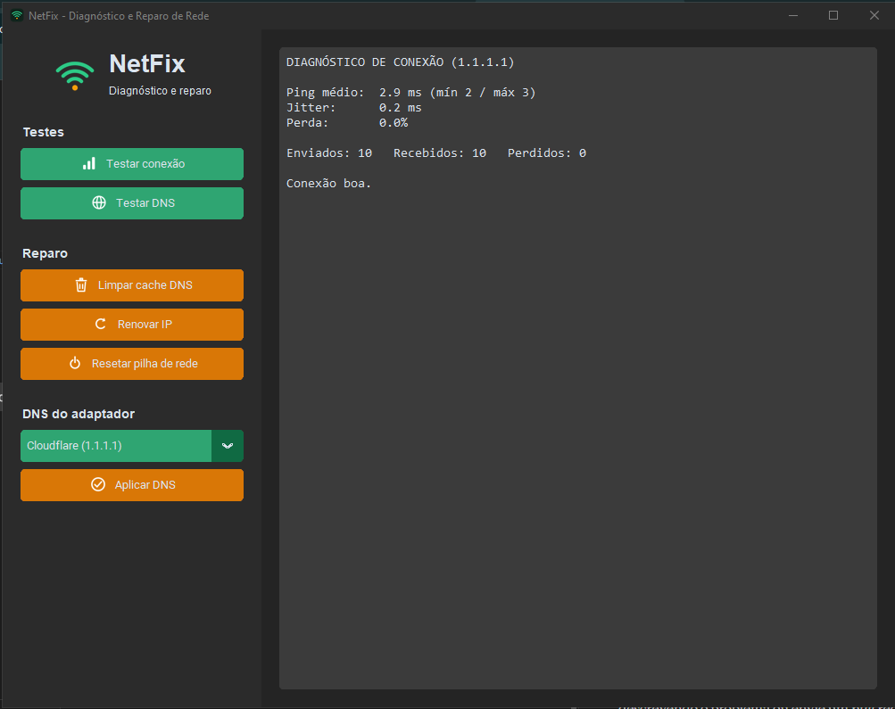

<p align="center">
  
</p>

<h1 align="center">NetFix</h1>

<p align="center">
  Aplicativo de diagnóstico e reparo de rede para Windows, com interface gráfica.
</p>


<p align="center"></p>

---

## Sobre

O NetFix testa a sua conexão, mostra onde está o problema e aplica os reparos mais comuns de rede com um clique, sem precisar abrir o Prompt de Comando.

## Funcionalidades

**Testes**

- **Testar conexão:** envia 10 pings para `1.1.1.1` e mostra ping médio, mínimo e máximo, jitter e perda de pacotes, com um veredito simples ("Conexão boa" ou o que está errado).
- **Testar DNS:** consulta o DNS do sistema e os servidores da Cloudflare (`1.1.1.1`) e do Google (`8.8.8.8`), com o tempo de resposta de cada um. Se o DNS do sistema falha mas os públicos respondem, o app aponta o problema e sugere a solução.

**Reparos**

- **Limpar cache DNS** (`ipconfig /flushdns`)
- **Renovar IP** (`ipconfig /release` e `/renew`)
- **Resetar pilha de rede** (`netsh winsock reset` e `netsh int ip reset`), com confirmação, pois exige reiniciar o computador
- **Trocar o DNS do adaptador:** Cloudflare, Google ou automático (DHCP). O app detecta sozinho o Wi-Fi ou Ethernet conectado.

**Outros detalhes**

- Os testes e reparos rodam em segundo plano, então a janela não trava.
- Aviso e botão "Reabrir como administrador" quando o app é aberto sem permissão.
- Tema escuro com [CustomTkinter](https://github.com/TomSchimansky/CustomTkinter).

## Requisitos

- **Windows 10 ou 11** (os reparos e a troca de DNS só funcionam no Windows)
- **Python 3.10 ou mais novo**, caso vá rodar pelo código-fonte
- **Permissão de administrador** para usar os botões de reparo

## Como usar

### Opção 1: executável (sem instalar Python)

Baixe o `NetFix.exe` na aba [Releases](../../releases) e execute. O Windows pode mostrar o aviso "O Windows protegeu seu computador", porque o programa não tem assinatura digital. Clique em **Mais informações** e depois em **Executar assim mesmo**.

### Opção 2: rodar pelo código-fonte

```bash
git clone https://github.com/yagofalmeida007-svg/Net-Fix.git
cd netfix
pip install -r requirements.txt
python main.py
```

Para os reparos funcionarem, abra o terminal como administrador, ou use o botão **Reabrir como administrador** dentro do app.

## Gerar o executável

No Windows, dê dois cliques no `build.bat`, ou rode:

```bash
python -m pip install -r requirements.txt pyinstaller
python -m PyInstaller --noconfirm --clean --onefile --windowed --name NetFix --uac-admin --noupx --icon assets\icons\app.ico --add-data "assets;assets" --collect-all customtkinter main.py
```

O arquivo final fica em `dist\NetFix.exe`. Ele já pede permissão de administrador ao abrir.

## Estrutura do projeto

```
netfix/
├── main.py                 # ponto de entrada
├── build.bat               # gera o .exe
├── gerar_assets.py         # gera logo e ícones (Pillow)
├── requirements.txt
├── assets/
│   ├── icons/              # ícone do app e ícones dos botões
│   └── images/             # logo
├── interface/
│   └── dashboard.py        # janela e botões
├── services/
│   ├── diagnostico.py      # ping, jitter e perda de pacotes
│   ├── dns.py              # teste de DNS (consulta UDP direta)
│   └── reparo.py           # comandos de reparo e troca de DNS
└── utils/
    └── recursos.py         # localiza os arquivos de assets (script e .exe)
```

## Como funciona

- **Ping:** usa o comando `ping` do sistema e lê o tempo de cada resposta. O jitter é a média da diferença entre pings consecutivos.
- **DNS:** os servidores públicos são consultados por UDP, na porta 53, sem depender do `nslookup`. Assim o teste funciona em qualquer idioma do Windows.
- **Reparo:** chama `ipconfig` e `netsh`. A troca de DNS usa o PowerShell (`Get-NetAdapter` e `Set-DnsClientServerAddress`).
- **Interface:** cada ação roda em uma thread, e o resultado volta para a tela por uma fila, o que evita travamentos.

## Aviso

Os botões de reparo alteram configurações de rede do computador. "Resetar pilha de rede" exige reiniciar o PC, e a troca de DNS pode ser desfeita com a opção **Automático (DHCP)**. Use por sua conta e risco.

## Contribuindo

Sugestões e correções são bem-vindas. Abra uma *issue* descrevendo o problema ou envie um *pull request*.
